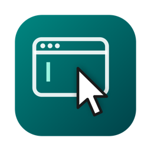

<p align="center"></p>

# Focus Follows Mouse

Rest the pointer on a window and it gets keyboard focus. No click needed.
A small, dependency-free menu bar app for macOS, replacing AutoRaise-style tools.

## Install

```bash
curl -fsSL https://raw.githubusercontent.com/hemanthtechey/focus-follows-mouse/main/install.sh | bash
```

1. When macOS asks, open System Settings and turn on **Focus Follows Mouse** under
   **Privacy & Security → Accessibility** (called *Device Control and Data Access* on newer macOS).
2. That's it. It starts at login automatically.

The app is built from source on your Mac, so there's no prebuilt binary to trust.
If the Command Line Tools aren't installed, the script opens their installer; run the command again afterwards.

From a clone instead: `git clone https://github.com/hemanthtechey/focus-follows-mouse.git && cd focus-follows-mouse && ./install.sh`

## Menu bar


| Icon | Meaning |
|---|---|
| Solid window + pointer | On |
| Faded | Off (paused from the menu) |
| ⚠ | Permission missing. Choose **Grant Permission…** |

Menu: **Enabled**, **Start at Login**, **Grant Permission…**, **Quit**. Hold **Control** to pause it temporarily.

## How it works

`focus.swift` checks the pointer every 100 ms. When it rests over an app window for about 200 ms,
that window is raised and its app made frontmost through the Accessibility API (`AXFrontmost`,
which takes effect immediately; `NSRunningApplication.activate()` is deferred on macOS 14+ and can land late).

It also reacts when the window *under a still pointer* changes, for example when a hotkey or drop-down
terminal slides away. A plain app switch (⌘-Tab) is left alone, so focus is never stolen back.

It stays out of the way:
- **Drags:** nothing happens while a mouse button is held.
- **Menu bar, Dock and desktop:** ignored. The desktop matters with Stage Manager, where focusing it hides your apps.
- **Popups:** never steals focus from launchers or Spotlight. Apps are judged by activation policy rather than
  window subrole, because some apps (e.g. iTerm2 3.7) report normal windows as `AXSystemDialog`.
- **App Nap:** disabled for this app, so the 100 ms timer isn't throttled.

## Notes

- Log: `~/Library/Logs/FocusFollowsMouse.log` (permission state and each focus switch).
- The build is ad-hoc signed. If you rebuild or reinstall, macOS sees a new app and you need to turn it on again.
- Build only: `./build.sh` (makes `Focus Follows Mouse.app` here). Install: `./build.sh --install`.

## Uninstall

```bash
curl -fsSL https://raw.githubusercontent.com/hemanthtechey/focus-follows-mouse/main/install.sh | bash -s -- --uninstall
```

## Licence

MIT, see [LICENSE](LICENSE).
